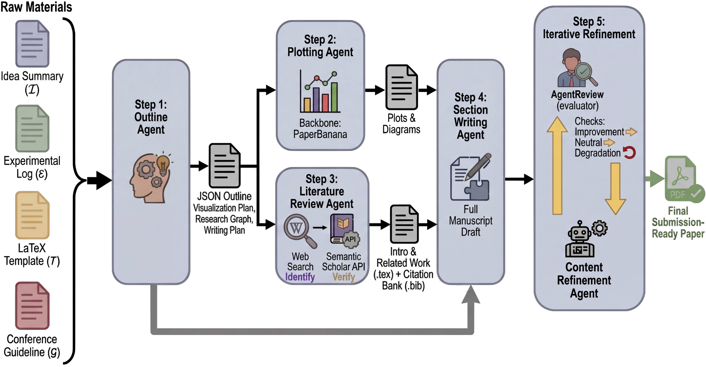

> **[中文化] paper-orchestra**
>
> 此项目是 [google-research/paper-orchestra](https://github.com/google-research/paper-orchestra) 的中文翻译版本。
> - 原项目 Stars: 4329
> - 主语言: Python
> - 许可证: Apache-2.0
> - 翻译日期: 2026-11-19
> - 原始 README: [README_en.md](README_en.md)
>
> 说明：下方 README 正文为**原项目文档的中文翻译**，力求忠于原文；本页顶部的「中文快速上手」为**面向中文用户的补充导读**（非原文内容），目的是让你不用读完整篇 README 就能先把项目跑起来。
>
> 如有翻译不准确之处，欢迎提 Issue 或 PR。

---


## 🚀 中文快速上手（补充导读，非原文）

### 这是什么 / 解决什么问题

PaperOrchestra 是 Google Cloud AI Research 开源的多智能体框架，用于自动化撰写 AI 研究论文。它把零散的写作前材料（想法、实验日志）转换成可投稿的 LaTeX 稿件，过程中包含文献综述、章节撰写、内容润色以及生成图表（如数据图和概念示意图）。它通过编排多个专职智能体（大纲、文献综述、章节写作、内容精修、绘图）来弥合原始研究材料与可投稿论文之间的差距。

### 快速上手（最短路径）

1. 创建并激活 Conda 环境（Python 3.11），安装依赖：
   ```bash
   conda create -n paper_orchestra python=3.11
   conda activate paper_orchestra
   pip install -r requirements.txt
   ```
2. 在项目根目录创建 `.env` 文件，填入所需 API Key（如 `SEMANTIC_SCHOLAR_API_KEY`、`OPENAI_API_KEY`、`GEMINI_API_KEY` 或 `VERTEX_AI_PROJECT`/`VERTEX_AI_LOCATION` 等；如需 demo 结束时给自己发邮件，再填 `SMTP_EMAIL`/`SMTP_PASSWORD`）。
3. 准备原始材料目录和 LaTeX 模板目录（模板可参考 `templates/` 下的示例，如 `templates/cvpr2025`）。
4. 运行生成流程，二选一：
   - 用 bash 脚本：`./paper_writing_cli.sh`
   - 或直接用 Python CLI：
     ```bash
     python paper_writing_cli.py \
       --raw_materials_dir /path_to_your_raw_materials/ \
       --latex_template_dir /path_to_your_latex_template/ \
       --output_dir /path_to_your_output_folder/ \
       --use_plotting true
     ```
5. （可选）运行交互式 Streamlit demo，具体说明见 `frontend/README.md`。

### 环境要求

- **操作系统**：原文未说明。
- **硬件**：原文未说明。
- **依赖**：Conda 环境（名为 `paper_orchestra`），Python 3.11；依赖清单见 `requirements.txt`（含 google-genai、openai、streamlit、matplotlib、PyMuPDF 等）。
- **版本要求**：Python 3.11（原文明确）。
- **API Key**：需要按所用模型配置相应密钥（Gemini 需 `GEMINI_API_KEY` 或 Vertex AI 的 `VERTEX_AI_PROJECT`/`VERTEX_AI_LOCATION`；OpenAI 需 `OPENAI_API_KEY`；文献检索需 `SEMANTIC_SCHOLAR_API_KEY`）。
- **网络提示**：原文未提及镜像源；国内用户安装 pip 依赖时如遇下载慢，可自行考虑更换镜像源。

### 常见坑与注意事项

- **数据集未随仓库提供**：用于论文生成的数据集不在代码库中，原文称将另行发布，届时需下载并放到 `datasets/` 目录下。
- **必须配置 API Key**：不填对应模型的密钥就无法使用相应模型；`.env` 中留空则相关功能不可用。
- **绘图默认关闭**：`--use_plotting` 默认为 `False`，需要生成图表时要显式设为 `true`。
- **非官方支持产品**：原文 Disclaimer 明确说明这不是 Google 官方支持的产品。

---


---

# <div align="center">🎻 PaperOrchestra：自动化 AI 研究论文写作的多智能体框架</div>
<div align="center">Yiwen Song<sup>1</sup>, Yale Song<sup>1</sup>, Tomas Pfister<sup>1</sup>, and Jinsung Yoon<sup>1</sup></div>
<div align="center"><sup>1</sup>Google Cloud AI Research</div>
<br><br>

PaperOrchestra 是一个用于自动化 AI 研究论文写作的多智能体框架。它能将不受约束的写作前材料（想法和实验日志）灵活转换为可直接投稿的 LaTeX 稿件，包括全面的文献综述和生成的视觉内容，如图表和概念示意图。

它像一支由专业智能体组成的编排团队，负责大纲生成、文献综述、章节写作、内容精炼和绘图，弥合原始研究材料与可投稿论文之间的差距。

<div align="center">
  
</div>

## 核心特性

- **多智能体流水线**：编排专业智能体（大纲、文献综述、章节写作、内容精炼、绘图），实现端到端论文生成。
- **全面文献综述**：自动搜索、排序并将相关文献整合到稿件中。
- **视觉内容生成**：生成图表，并支持纳入概念示意图。
- **LaTeX 自动化**：生成符合目标会议模板的可投稿 LaTeX 稿件。

## 安装

1.  **环境配置**：项目依赖名为 `paper_orchestra` 的 Conda 环境。你可以用 Python 3.11 搭建类似环境并安装所需依赖。
    ```bash
    conda create -n paper_orchestra python=3.11
    conda activate paper_orchestra
    pip install -r requirements.txt
    ```

2.  **环境变量**：在项目根目录创建 `.env` 文件并添加 API 密钥：
    ```env
    # Add keys if you have them, otherwise leave them empty
    # You need to specify related keys if you want to use the model
    # For example, if you want to use Gemini models, you need to specify either VERTEX_AI_PROJECT and VERTEX_AI_LOCATION, or GEMINI_API_KEY
    # If you want to use OpenAI models, you need to specify OPENAI_API_KEY
    
    SEMANTIC_SCHOLAR_API_KEY=your_semantic_scholar_api_key
    OPENAI_API_KEY=your_openai_api_key
    VERTEX_AI_PROJECT=your_vertex_ai_project
    VERTEX_AI_LOCATION=your_vertex_ai_location
    GEMINI_API_KEY=your_gemini_api_key

    # if you want to run demo and send emails to yourself at the end, set these 2 fields as well
    SMTP_EMAIL=your_email
    SMTP_PASSWORD=your_password
    ```

## 数据集

用于论文生成的数据集**未包含**在本代码仓库中，将于日后单独发布。
数据集发布后，请下载并放置到 `datasets/` 目录下。

## 使用

你可以使用提供的 bash 脚本或直接通过 Python CLI 运行论文生成流水线。

### 使用 Bash 脚本
```bash
./paper_writing_cli.sh
```

### 直接使用 Python CLI
```bash
python paper_writing_cli.py \
  --raw_materials_dir /path_to_your_raw_materials/ \
  --latex_template_dir /path_to_your_latex_template/ \
  --output_dir /path_to_your_output_folder/ \
  --use_plotting true
```

### 关键参数
*   `--raw_materials_dir`：（必填）包含原始材料（如想法和实验日志）的目录。
*   `--latex_template_dir`：（必填）包含 LaTeX 模板的目录（如 `templates/cvpr2025`）。
*   `--output_dir`：生成论文的输出目录。未指定时，自动创建带时间戳的文件夹。
*   `--use_plotting`：启用绘图智能体工作流，从代码生成图（默认：`False`）。
*   `--writer_model_name`：写作和文献智能体使用的 LLM。
*   `--reflection_model_name`：反思智能体使用的 LLM。

### 交互式演示

我们为论文生成流水线提供了交互式 Streamlit 演示。运行和使用说明请参阅 `frontend` 目录下的 [README.md](frontend/README.md)。

## 项目结构

*   `autoraters/`：包含自动化评估脚本。
*   `methods/`：智能体和流水线执行的核心逻辑。
*   `templates/`：目标会议的 LaTeX 模板。你可以在该目录下新建子文件夹来添加自己的模板。
*   `utils/`：API 调用、PDF 处理等工具函数。

## 引用

如果你觉得本仓库或我们的论文有帮助，请按以下格式引用：

```bibtex
@article{song2026paperorchestra,
  title={PaperOrchestra: A Multi-Agent Framework for Automated AI Research Paper Writing},
  author={Song, Yiwen and Song, Yale and Pfister, Tomas and Yoon, Jinsung},
  journal={arXiv preprint arXiv:2604.05018},
  year={2026}
}
```

# 免责声明

本项目并非 Google 官方支持的产品。